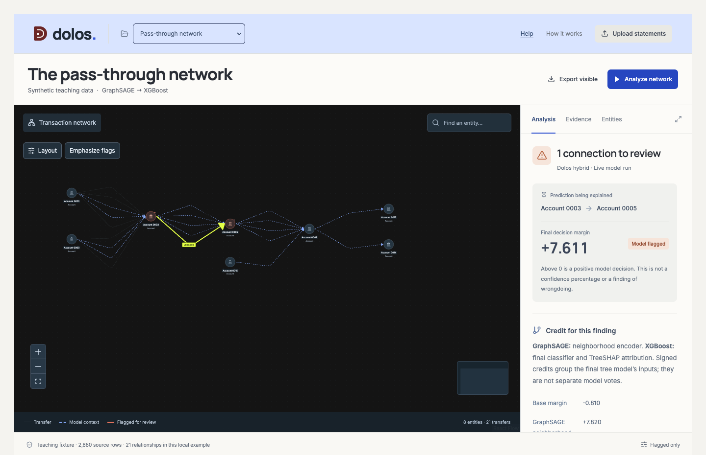
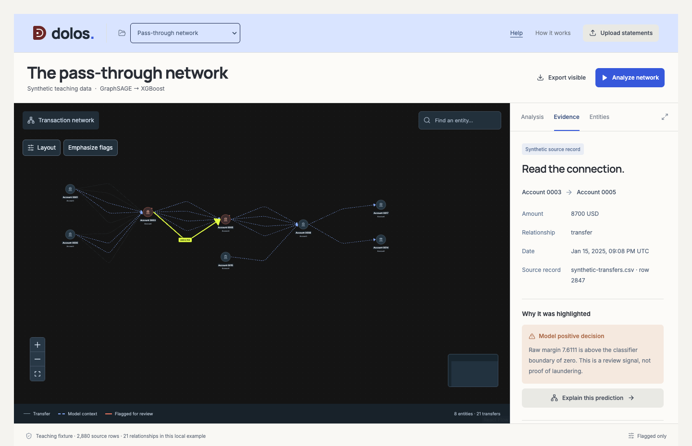

# Dolos

Dolos is a transaction review workspace. Import PDF, CSV, or JSON statements to see who paid whom, trace transfers through an account network, and prioritize records for human review. Select a transfer in the graph or ledger to see the source record and, when a model score is available, what contributed to it.



*The synthetic pass-through example highlights a transfer from Account 0003 to Account 0005. Dashed edges show earlier transfers used as model context.*

## Try an investigation

1. [Run Dolos locally](#run-locally) and choose **Pass-through network**.
2. Click **Analyze network**. Select the highlighted transfer or find it in the transaction ledger.
3. Open **Analysis** to inspect the decision margin and the contributions from account history and transaction fields. Open **Evidence** to see the amount, timestamp, and source row.



*The Evidence tab traces the selected USD 8,700 transfer to row 2847 in the synthetic source CSV.*

To try ingestion, unzip the [sample statement bundle](frontend/public/dolos-video-statements.zip) and upload the four PDFs together. Their embedded CSV exports contain 1,200 synthetic transfers and require no extraction API key. For a smaller upload, use the [example CSV](examples/statement.csv).

## Run locally

Use [the repository's Nix development shell](flake.nix) for Rust, Node, pnpm, uv, and Poppler. Run the following commands from the repository root in separate terminals.

If the ONNX files are missing, export them from the included trained weights before starting the API. **Analyze network** requires these files.

```sh
nix develop --command uv run tools/export_onnx.py
```

**API**

```sh
nix develop --command cargo run --locked --release --manifest-path backend/Cargo.toml
```

**Web app**

```sh
nix develop --command pnpm --dir frontend install --frozen-lockfile
nix develop --command pnpm --dir frontend dev
```

Open <http://127.0.0.1:5173>. Vite proxies API calls to port 8000. Dolos uses SQLite and local file storage by default.

The endpoint `/api/demo/model/status` reports whether live scoring is available.

### Configuration

Set API options as environment variables. The API does not load [.env.example](.env.example) automatically.

| To | Set |
| --- | --- |
| Score uploaded transfers | `DOLOS_MODEL_DIR` to a compatible ONNX bundle. Use `dolos/demo_assets/artifacts` to score the synthetic sample bundle. |
| Extract PDFs that lack an embedded export | `OPENROUTER_API_KEY` for the default provider, or the OpenAI settings in [.env.example](.env.example). |
| Change where statements and rows are stored | Set the file storage and database options in [.env.example](.env.example). Local files and Cloudflare R2 are supported for uploads. SQLite and remote libSQL are supported for rows. |
| Require API authentication | Set `DOLOS_API_KEY` for the API and the Vite proxy in development. In deployment, configure your authenticated reverse proxy to supply the bearer header. |

### Run with Docker

Build from the repository root. For live demo scoring, export any missing ONNX files before building. The image serves both the web app and the API at <http://127.0.0.1:8000>.

```sh
docker build -t dolos .
docker run --rm -p 127.0.0.1:8000:8000 -v dolos-data:/app/data dolos
```

For a public demo that accepts no uploads, set `DOLOS_DEMO_ONLY=1` and leave `DOLOS_API_KEY` unset. Visitors can inspect and analyze the bundled synthetic examples.

The [Railway deployment](https://dolos-production.up.railway.app/) serves the frontend and Rust API together. For a separate Vercel frontend, set its project root to `frontend`. [The Vercel rewrite](frontend/vercel.json) forwards `/api/*` to Railway and keeps browser requests on the frontend's origin.

## How scoring works

The [Rust API](backend/src/main.rs) validates statement rows and builds a directed graph of accounts and transfers. The [React workspace](frontend/src/App.tsx) links each transfer to the ledger and its source record.

GraphSAGE summarizes the sender's and recipient's earlier incoming and outgoing transfers. XGBoost combines those summaries with transaction fields such as amount, currency, and payment format. TreeSHAP attributes the decision margin to groups of model inputs. Dolos labels rule-based findings, such as rapid pass-through, separately from model scores. Missing fields can leave a transfer ineligible for model scoring.

## Evaluation

The [evaluation notebook](dolos.ipynb) compares two models on the same chronological test split of 432 synthetic transfers, including 144 labeled routing transfers. Each prediction uses graph history from before the target hour.

| Model | Average precision | Precision at 100 |
| --- | ---: | ---: |
| Transaction-only XGBoost | 0.976999 | 0.980 |
| GraphSAGE → XGBoost | 1.000000 | 1.000 |

The training and test data came from the same generator. These results measure how well the models recognize the simulated patterns. Real-world accuracy remains unmeasured. Use Dolos scores to prioritize human review. A flag alone does not establish wrongdoing. 

This project does not provide financial advice, double check any statement with a reputable source before making a decision
